 

## 🎯 Focus

어떤 분야든 구현보다 **아키텍처**를 먼저 생각합니다.
설계 원칙과 경계를 먼저 정하고, 필요한 만큼만 단순하게 구조를 만들며, 비용과 운영까지 고려해 선택합니다.

백엔드와 인프라를 중심으로 다음 분야에 관심을 두고 있으며, 로컬 LLM과 생성형 이미지는 직접 구축해 실험합니다.

- **Cloud & Local Infrastructure**
- **Local LLM**
- **Generative Image**
- **Backend Architecture**
- **Game Development**

## 🛠 Tech Stack

  

## 📊 GitHub Stats

  
  

## 📫 Contact

